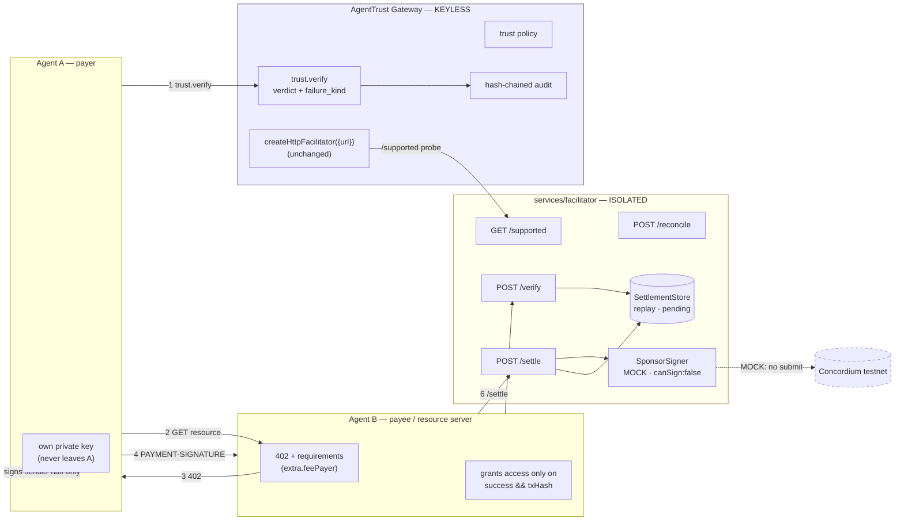

# TASK 25 — Isolated x402 Concordium Facilitator Prototype

Date: 2026-11-05 · An isolated mock-signer facilitator under `services/facilitator/`, proven
compatible with the unchanged gateway, with replay/idempotency/pending safeguards.
**36 new tests; 1032/1032 across 25 suites. No real transaction, no signing, no key access.**

## Verdict

The prototype meets every completion condition: it passes its own tests, the **unchanged**
gateway recognizes its scheme, replay and ambiguous-settlement cases fail safely, and every
existing regression passes.

**It does not demonstrate a real x402 payment, and does not claim to.** The mock signer cannot
sign; nothing in this service can reach a chain.

---

## 1. Architecture and trust boundaries



Decorative people: the gateway box has **no key** in it, and the mock signer's arrow to the chain
is dotted because it never happens.

### Trust boundaries, stated as invariants

| # | Invariant | How it holds |
|---|---|---|
| 1 | Gateway holds no sponsor key | the gateway imports nothing from `services/facilitator`; the signer lives in the isolated service only |
| 2 | Sponsor credentials never in this repo | `services/facilitator/src/` contains **zero** `privateKey`/`mnemonic`/`keystore`/`wallet` identifiers — the single grep hit is the comment saying so |
| 3 | No signer implementation that could sign | `createSigner()` throws in `real` mode; only `createMockSigner` exists, and it reports `canSign: false` |
| 4 | Mock cannot be mistaken for real | `canSign:false` on `/healthz`; every settle response carries `extra.simulated:true`; mock hashes are prefixed `simulated-` |
| 5 | Mock must not be remotely reachable | `loadConfig` refuses any `mock` bind address outside loopback |
| 6 | Mainnet out of scope | `loadConfig` refuses the mainnet CAIP-2 and any non-testnet network |
| 7 | Gateway stays fail-closed | `DENY_ALL_FACILITATOR` untouched; `authorizePayment({settle})` still defaults `false`; no gateway file changed |
| 8 | Payer key never enters the facilitator | the service never accepts a client signer; it only receives an already-signed payload |

---

## 2. Files

| File | Purpose |
|---|---|
| `services/facilitator/package.json` | isolated package, `private: true`, own scripts |
| `services/facilitator/tsconfig.json` | own build; **not** part of the gateway's `tsc` |
| `services/facilitator/src/config.ts` | fail-closed configuration + sponsor address shape validation |
| `services/facilitator/src/signer.ts` | `SponsorSigner` interface + the **only** implementation, a mock |
| `services/facilitator/src/store.ts` | replay digests, idempotency state, pending store, reconciliation |
| `services/facilitator/src/core.ts` | `/supported`, `/verify`, `/settle` logic over the mock signer |
| `services/facilitator/src/server.ts` | HTTP surface, body cap, loopback-only CLI entry |
| `test/task25-facilitator.test.mts` | 36 tests |
| `scripts/task25-compat.mts` | gateway ↔ service compatibility proof |
| `docs/archive/TASK25-result.md` | this report |

**No file under `src/` was modified.** The gateway was not touched.

---

## 3. Gateway compatibility — verified against the real service

Run against the isolated service started on an ephemeral loopback port, using the gateway's own
unmodified code:

```console
$ npx tsx scripts/task25-compat.mts
facilitator url: http://127.0.0.1:40393
probeFacilitator: {"ok":true,"status":200,"kind":"none"}
classifyCompatibility: {"usable":true,"code":"OK",
  "feePayer":"3mockSponsorPlaceholderNotARealAccountAddress0000","schemes":["exact"]}
createHttpFacilitator.getSupported: 1 kind(s), ["ccd:4221332d34e1694168c2a0c0b3fd0f27"]

VERDICT: gateway ACCEPTS the isolated facilitator unmodified
```

Live `/supported` from the standalone process:

```json
{"kinds":[{"x402Version":2,"scheme":"exact",
  "network":"ccd:4221332d34e1694168c2a0c0b3fd0f27",
  "extra":{"feePayer":"3mockSponsorPlaceholderNotARealAccountAddress0000"}}],
 "extensions":[],
 "signers":{"ccd:*":["3mockSponsorPlaceholderNotARealAccountAddress0000"]}}
```

`/healthz` → `{"ok":true,"mode":"mock","network":"ccd:4221…","canSign":false}`.

No gateway code, constant, or type was changed to achieve this.

---

## 4. Replay, idempotency and pending safeguards

Three separate concerns, deliberately not merged:

| Concern | Behaviour |
|---|---|
| **Replay** | Keyed by a digest of the *payment* (excluding `resource.url`). One signed transaction pays one recipient one amount **once**, not once per endpoint. |
| **Idempotency** | A duplicate `/settle` for an already-settled payment returns the **same** transaction hash with `extra.idempotentReplay: true`. It does not settle again and does not fail. |
| **Pending** | A submission whose outcome was not established returns `success:false`, `errorReason:'settlement_pending'`, the broadcast hash, and `extra.nonTerminal:true`. It is **never** success and is **never** auto-retried. |
| **Reconciliation** | Only an explicit observation for **that exact hash** moves pending forward, and only `finalized` becomes settled. `committed` stays pending. A mismatched hash is refused. |

### A defect found and fixed during this task

The first implementation keyed replay on the whole payload, **including `resource.url`**. That
made one signed transaction redeemable once per resource URL — the exact double-spend the
safeguard exists to prevent. Reproduced, then fixed:

```console
--- before: same payload, different resource ---
first settle: true simulated-000001a1ac4bf94c
replay verdict: {"isValid":true, ...}          ← ACCEPTED (bug)

--- after: keyed by paymentDigest (resource excluded) ---
replay verdict: {"isValid":false,"invalidReason":"replay"}
```

Two of the five initial test failures were **my fixtures**, not the code, and were corrected
rather than papered over: a field-mismatch test that mutated both sides of a comparison (a
tautology), and an HTTP test whose fixture expiry sat outside spec rule 7 under the real clock.

---

## 5. Tests and exact results

```console
$ (cd services/facilitator && npx tsc -p tsconfig.json)   → exit 0
$ npx tsx test/task25-facilitator.test.mts                → 36/36 passed
```

| Group | Coverage |
|---|---|
| Configuration (01–07) | mode mandatory; unknown modes refused; `real` cannot start; mainnet/non-testnet refused; mock must be loopback and must not receive a sponsor; real requires a shape-valid sponsor; shape validator is format-only |
| Signer (08–10) | `canSign:false`; no key-bearing members; `addSponsorSignature` produces no signature; fake hashes prefixed `simulated-`; finalization marked simulated |
| Compatibility (11–14) | `/supported` shape; gateway probe **and** classifier accept it; `createHttpFacilitator` reads it over HTTP; `/healthz` reports mock + `canSign:false` |
| `/verify` (15–19) | well-formed payload verifies; malformed envelopes refused; per-field disagreement refused (5 fields); expired refused; over-far expiry refused (rule 7) |
| `/settle` success (20–22b) | first settle returns a fake hash; duplicate is idempotent with the same hash; **same payment against a second resource refused**; different amount refused |
| Ambiguity (23–29) | submission throw → pending; pending is not retried; broadcast-unconfirmed → pending **with hash**; `committed` stays pending; `failed` is terminal; reconciliation cannot invent success; a failed payment needs a new payload |
| HTTP surface (30–32) | x402-shaped JSON; malformed JSON 400; oversized body 413; unknown route 404 |
| Store (33–35) | digest stability and key-order independence; requirements key distinguishes recipient/amount/asset/network/resource; TTL expiry never yields success |

### Full regression

```console
$ npm test   → all suites passed   25 suites · 1032/1032
$ npx tsc --noEmit                             → gateway typecheck OK
$ (cd services/facilitator && npx tsc --noEmit) → facilitator typecheck OK
```

| Suite | Result |
|---|---|
| **task25-facilitator (new)** | **36/36** |
| task23-verdict-semantics | 21/21 |
| task22 / task21 / task20 | 15/15 · 20/20 · 37/37 |
| task19-mcp-interop | 13/13 |
| task08-mcp-interface | 39/39 |
| task07-facilitator-readiness | 30/30 |
| task05-commerce | 36/36 |
| task04-x402-exact / sdk-conformance | 44/44 · 15/15 |
| task03 / task06 / task06.1 / task10–15 | unchanged |
| **Total** | **1032/1032 across 25 suites** |

### Gateway remains fail-closed

- `DENY_ALL_FACILITATOR.verify/settle` still throw `no facilitator configured`.
- `authorizePayment({ settle })` still defaults to `false`.
- Commerce MCP path still uses `mockFacilitator` only; no real facilitator is constructed anywhere
  in `src/`.
- Token 1004: **TRUSTED**, exit 0, `3f6144046d843b7bae1b071f279e26c4dc0c4711a30b925220c1dbf94aeab564`
  (local = on-chain).
- On-chain: `nonce 4`, `19943619923` microCCD — unchanged since TASK 02.

**Zero transactions. Zero signing. Zero settlement. No key read, exported, or logged.**

---

## 6. Known limitations

1. **This is a mock. It proves protocol shape, not payment capability.** No signature was
   produced, no transaction was submitted, and no chain was contacted. Any claim that "x402
   payments work on Concordium" remains unproven by this task.
2. **The mock's "transaction hash" is `simulated-<hex>`.** It is deliberately not hash-shaped so
   it cannot be mistaken for a real digest, which also means the reconciliation path is exercised
   against synthetic identifiers only.
3. **State is in-memory.** `SettlementStore` is per-process. A restart forgets every replay and
   pending entry, so a multi-instance or restart-surviving deployment needs a shared store before
   it can be trusted with real money.
4. **No authentication on the HTTP surface.** It binds loopback and is meant to be reachable only
   by the payee, but there is no request authentication at all.
5. **`committed` is treated as not-settled.** Conservative and correct for safety, at the cost of
   latency: a payment needs finalization, not commitment.
6. **Replay TTL is time-based only.** An entry older than `FACILITATOR_REPLAY_TTL_MS` is forgotten,
   so a sufficiently old payload could be re-presented. The transaction's own expiry bounds this in
   practice, but the store does not.
7. **No idempotency across processes** — see 3.
8. **`/reconcile` is unauthenticated** and trusts its caller's observation. It cannot invent
   success for a hash it did not record, but it does trust a claimed `finalized`.

---

## 7. Exact operational prerequisites for a real Testnet payment

Ordered, and all of them required:

1. **A sponsor account on Concordium testnet**, separately provisioned and funded with testnet CCD.
   It pays every transaction fee. Its key must be created and held by whoever operates the
   facilitator — not by AgentTrust, not in this repository.
2. **A real `SponsorSigner` implementation**, replacing the mock: something that can
   `addSponsorSignature` and `submitTransaction` against a gRPC node. The interface already exists;
   the implementation is the deliberate gap.
3. **A funded payer account** for Agent A, with its key in Agent A's own process.
4. **The gateway pointed at the service** via `createHttpFacilitator({ url })` — no gateway code
   change needed, as §3 shows.
5. **Replay and pending state moved off-process** (see limitation 3) if more than one instance or
   restart survival is required.
6. **`settle` enabled explicitly** for the run — it is still `false` by default and must stay that
   way until a verify-only dry run passes.

---

## 8. Does the next phase require a separately provisioned and funded sponsor account?

**Yes. Unambiguously.**

- The scheme requires `extra.feePayer` — the client cannot even build a payload without it
  (`@x402/concordium` `chunk-P7DLOXRQ.mjs:60`).
- The facilitator must add a sponsor signature and submit, which needs a funded account.
- This repository must not hold that key (TASK 24 boundary, preserved here: `real` mode throws
  rather than offering a key-loading path).
- AgentTrust's existing 450 testnet CCD belongs to the **registry operator account**, not to a
  sponsor, and must not be repurposed.

So TASK 26 cannot begin until a sponsor account exists outside this repository and its operator
supplies a signer. Nothing in the code blocks it; the provisioning does.

---

## 9. VERIFIED / NOT TESTED / BLOCKED

### VERIFIED
- Isolated service builds and typechecks independently of the gateway.
- `/supported`, `/verify`, `/settle`, `/reconcile`, `/healthz` all answer correctly over HTTP.
- The **unchanged** gateway's `probeFacilitator`, `classifyCompatibility` and
  `createHttpFacilitator` all accept it (`usable:true`, `code:'OK'`).
- Replay is refused across different resources and different amounts.
- Duplicate settle is idempotent and returns the same hash.
- `settlement_pending` is non-terminal, never success, never auto-retried, and carries a hash for
  reconciliation.
- Reconciliation cannot convert an unknown outcome into success; a mismatched hash is refused;
  `finalized` is required.
- The mock signer provably cannot sign (`canSign:false`) and the service contains no key-bearing
  identifier.
- `real` mode fails closed; mainnet is refused; mock binds loopback only.
- Gateway remains deny-by-default, settle-disabled, and unmodified; 1032/1032 tests pass;
  token 1004 TRUSTED with an unchanged hash; on-chain state unchanged.

### NOT TESTED
- Any real signature, submission, or chain interaction — none was attempted.
- A real x402 payment payload (requires a signer).
- Multi-instance or restart-surviving replay state.
- Concurrent settle races on the same payload across processes.
- Behaviour against a real gRPC node (no node was contacted by this service).

### BLOCKED
- **A real Testnet payment.** Blocked on a separately provisioned, funded sponsor account and a
  real `SponsorSigner` implementation — both deliberately outside this repository. This is the
  same B1/B2 blocker TASK 24 identified, now narrowed to a single provisioning step.

## Stop condition

TASK 25 is complete as scoped. **Nothing was committed or pushed; no GitHub setting changed; no
npm publication occurred; token 1004 and its registration were not modified.** Waiting for
explicit approval before accessing any sponsor credential or attempting a real Testnet payment.
