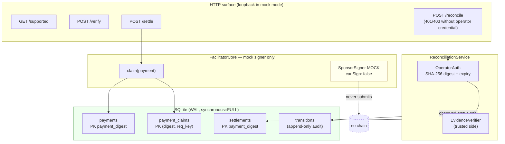

# TASK 26 — Durable Settlement State & Reconciliation Security

Date: 2026-11-05 · SQLite-backed durable settlement state, TTL-independent replay protection,
authenticated reconciliation behind a trusted evidence boundary, and an explicit state machine.
**32 new tests; 1096/1096 across 26 suites.** Still mock-only: no signing, no submission, no chain.

## Completion criteria — all met

| Criterion | Status | Evidence |
|---|---|---|
| Replay protection survives restart **and** TTL expiry | **yes** | test 04, 05, 11 (clock advanced one year) |
| Concurrent duplicate requests cannot double-settle | **yes** | test 13 (in-process), **13b (4 real OS processes)** |
| Pending records survive restart | **yes** | test 03, 05, 31 |
| Unauthenticated reconciliation cannot change state | **yes** | test 27 (route absent), 28, 30 |
| Caller claims alone cannot establish finality | **yes** | test 18, 29 |
| Only verified evidence can finalize | **yes** | test 20 vs 21, 22, 24 |
| All existing tests green | **yes** | 1096/1096, 26 suites |

---

## 1. Architecture and trust boundaries



### Boundaries, as invariants

| # | Invariant | Mechanism |
|---|---|---|
| 1 | A caller cannot state finality | `/reconcile` reads **no** `status`/`observed`/`finalized` field. Only `paymentDigest` and an optional echoed `transaction`. |
| 2 | Only a trusted verifier can report a chain status | `EvidenceVerifier` is constructed by the operator, not the caller. The fixture verifier answers from a fixed table and cannot be steered. |
| 3 | Evidence is bound to the recorded hash | `ReconciliationService` reads the hash from storage; the caller may repeat it but a mismatch is refused before any verifier is asked. |
| 4 | A verifier answering about a different hash is not trusted | `createSignerBackedVerifier` rejects a response whose `txHash` differs from the request. |
| 5 | Unauthenticated state change is impossible | `/reconcile` returns **404** when reconciliation is disabled; 401/403 otherwise. |
| 6 | Mock mode stays loopback-only | unchanged from TASK 25 (`loadConfig`) |
| 7 | No key material in this repository | grep over `services/facilitator/src/` finds none; `real` mode still throws in `createSigner` |
| 8 | Gateway unchanged and fail-closed | no `src/` file touched for this task; `DENY_ALL_FACILITATOR` intact |

---

## 2. Storage and retention guarantees

Backed by **`node:sqlite`** — built into Node ≥ 22.5, so **no new dependency and no native build**.

```sql
PRAGMA journal_mode = WAL;
PRAGMA synchronous = FULL;
```

| Table | Key | Enforces |
|---|---|---|
| `payments` | `PRIMARY KEY (payment_digest)` | one row per signed payment, whatever the process does |
| `payment_claims` | `PRIMARY KEY (payment_digest, requirements_key)` | a payment can be consumed for exactly one authorisation — at the storage layer, not in an `if` |
| `settlements` | `PRIMARY KEY (payment_digest)` | one settlement record per payment ⇒ duplicate submit cannot create a second row |
| `transitions` | autoincrement | append-only audit: `from_state`, `to_state`, `reason`, `tx_hash`, evidence digest, timestamp |

### Transactional writes

Every mutation runs inside `BEGIN IMMEDIATE … COMMIT` with `ROLLBACK` on throw (`repository.tx`).
Test 06 injects a throw mid-transaction and asserts the partially-applied `UPDATE` did not land.

### Retention policy

**There is no TTL on replay records.** A settled payment stays reserved forever, because its reuse
could cause a duplicate payment at any future time. This is the deliberate answer to TASK 25's
limitation 6.

**Bounded-storage compromise, stated explicitly:** the database grows monotonically with the number
of settled payments. There is no pruning, vacuum schedule, or archival policy. At a realistic
throughput this is small (one row plus a few transition rows per payment), but it is unbounded in
principle and an operator running this for a long time would need a retention policy that preserves
replay keys while dropping old audit rows. **That work is not done here.**

`replayTtlMs`/`pendingTtlMs` remain in the config for the *in-memory* helper only and no longer
govern durability.

### Backup / corruption / recovery

| Situation | Behaviour |
|---|---|
| Backup | WAL mode: copy the database with `sqlite3 .backup` or after a checkpoint. Copying the `.db` alone while a writer is active can miss the `-wal` file. |
| Corruption at open | **fails loudly** — test 07 writes garbage over the file and asserts opening/querying throws `not a database`-class error, rather than silently reading an empty database (which would otherwise look like "no payments recorded" and re-allow every replay). |
| Crash mid-write | transaction rollback on next open; WAL replays committed frames |
| Restart | pending records are recovered as pending and are **not** auto-retried (test 05) |
| Manual repair | out of scope; documented rather than automated |

---

## 3. Authentication model

`/reconcile` requires `Authorization: Bearer <token>`.

- The server stores **only a SHA-256 digest** (`FACILITATOR_OPERATOR_TOKEN_SHA256`), so the process
  never holds the plaintext and a config leak is not directly a usable credential.
- Comparison is `timingSafeEqual` over the digests.
- Optional `FACILITATOR_OPERATOR_TOKEN_EXPIRES_AT` (epoch ms) bounds a maintenance window.
- Failure codes are distinct — `missing`, `malformed`, `invalid`, `expired`, `not_configured` — so
  operators can debug, and **the token itself is never logged**.
- `FACILITATOR_RECONCILE_ENABLED=1` without a digest is a **startup error**, not a warning. Without
  the flag, the route returns 404 as if it did not exist (test 27).

`hashOperatorToken()` is exported so an operator can generate the digest without editing code.

---

## 4. Reconciliation evidence model

```
caller ──paymentDigest(+ optional echoed tx)──▶ ReconciliationService
                                                   │
                                   1. auth (operator only)
                                   2. shape (no status field exists)
                                   3. load recorded payment
                                   4. bind to RECORDED hash  ── mismatch ⇒ refuse
                                   5. ask EvidenceVerifier   ── caller has no input
                                   6. apply only if evidence agrees
                                                   │
                                          unchanged ⇐ evidence unavailable / committed / pending / unknown
                                          finalized ⇐ verified 'finalized'
                                          failed    ⇐ verified 'failed' | 'rejected'
```

Observation semantics, documented as required:

| Observed | Interpreted as | State outcome |
|---|---|---|
| `finalized` | verified, irreversible | `settlement_pending` → `finalized` |
| `committed` | **not final** | stays `settlement_pending` (test 21) |
| `pending` | not final | stays pending |
| `unknown` | no information | stays pending |
| `failed` | terminal rejection | `settlement_pending` → `failed` |
| `rejected` | terminal rejection | `settlement_pending` → `failed` |
| *unavailable* | cannot verify | stays pending, reason recorded (test 22) |

---

## 5. State transition table

| From | To | Allowed | Guard |
|---|---|---|---|
| `created` | `settlement_pending` | ✅ | the atomic claim (first settlement attempt) |
| `created` | `failed` | ✅ | submission refused before anything left the process |
| `created` | `finalized` | ❌ | must be broadcast first — test 01 |
| `settlement_pending` | `finalized` | ✅ | **only** with verified `finalized` evidence |
| `settlement_pending` | `failed` | ✅ | verified `failed`/`rejected` |
| `settlement_pending` | `settlement_pending` | ✅ (no-op) | carries no state change and never counts as success |
| `finalized` | anything | ❌ | terminal — test 01, 25 |
| `failed` | `finalized` | ❌ | **failure cannot become success** — test 24 |

- Illegal transitions raise `IllegalTransitionError` and are refused by the repository.
- Duplicate finalization is idempotent: `changed:false`, still `finalized`, and exactly **one**
  finalize entry in the transition log (test 25).
- No automatic resubmission: a pending claim returns `settlement_pending`, never a new submission
  (tests 05, 21, 22).
- Every transition is audited with reason, hash, evidence digest and timestamp (test 26).

---

## 6. Defects found and fixed during this task

Three genuine defects surfaced while writing the tests — all in my own TASK 25/26 code:

1. **`transaction` is a reserved word in SQLite.** The `settlements`/`payments`/`transitions` columns
   were named `transaction`, which failed at the first prepared statement (`near "transaction":
   syntax error`). Renamed to `tx_hash` throughout, including the row types.
2. **`claim()` refused a `created` row instead of claiming it.** `noteVerified` creates the row in
   `created`; `claim()` only handled the "already exists" branches, so the *first* settlement of
   every payment returned `in_progress` and the payment could never advance. Fixed by claiming
   `created`+`attempted=0` and moving it to `settlement_pending` in the same transaction.
3. **The success path never recorded the hash before applying evidence**, so finalization had no
   recorded transaction to bind to and reconciliation refused it. Fixed with an explicit
   `recordTransaction()` step that also makes subsequent duplicate settles idempotent.

Also corrected: the TASK 25 test that called `core.reconcile(...)` — that shortcut no longer exists,
because reconciliation now requires authentication plus a verifier. The test now asserts the
stronger fact that the core *cannot* finalize on its own; the state-machine coverage moved to the
TASK 26 suite.

---

## 7. Files changed

| File | Change |
|---|---|
| `services/facilitator/src/repository.ts` | **new** — SQLite durable store, atomic claim, evidence-bound reconcile, append-only transitions |
| `services/facilitator/src/state.ts` | **new** — state machine, transition table, observation interpretation |
| `services/facilitator/src/auth.ts` | **new** — digest-based operator auth with expiry |
| `services/facilitator/src/evidence.ts` | **new** — `EvidenceVerifier` interface + fixture and signer-backed verifiers |
| `services/facilitator/src/reconcile.ts` | **new** — authenticated, evidence-bound reconciliation service |
| `services/facilitator/src/core.ts` | uses the durable repository; claims instead of guards; finalization goes through verified evidence |
| `services/facilitator/src/config.ts` | `FACILITATOR_DB_PATH`, `FACILITATOR_RECONCILE_ENABLED`, operator token digest + expiry; real mode refuses `:memory:` |
| `services/facilitator/src/server.ts` | `/reconcile` gated behind auth + enablement; reads no status field |
| `test/task26-settlement-durability.test.mts` | **new**, 32 tests |
| `test/task25-facilitator.test.mts` | test 28 updated to the new (stronger) contract |
| `docs/archive/TASK26-result.md` | this report |

**No gateway `src/` file was modified.** `src/audit/lock.ts` untouched.

---

## 8. Exact test results

```console
$ (cd services/facilitator && npx tsc -p tsconfig.json --noEmit)  → facilitator typecheck OK
$ npx tsx test/task26-settlement-durability.test.mts              → 32/32 passed
$ npx tsx test/task25-facilitator.test.mts                        → 36/36 passed
$ npm test                                                        → all suites passed
$ npx tsc --noEmit                                                → gateway typecheck OK
```

**26 suites · 1096/1096 tests.** Named suites: task26 **32/32**, task25 **36/36**,
task23 21/21, task22 15/15, task21 20/20, task20 37/37, task19 13/13, task08 39/39,
task07 30/30, task05 36/36, task04-x402 44/44, task03 47/47.

### Coverage against the required list

| Required | Test |
|---|---|
| Restart recovery | 03, 31 |
| Persisted replay rejection | 04 |
| Persisted pending recovery | 05 |
| Interrupted write behaviour | 06 |
| Corrupt database behaviour | 07 |
| Concurrent duplicate requests | 13, **13b (4 processes)** |
| Same payment across different resources | 10 |
| Same payment after TTL expiry | **11 (clock +1 year)** |
| Same payment after restart | 04 |
| Concurrent replay attempts | 13, 13b |
| Different recipient/amount/asset/network | 12 |
| Missing / invalid / expired authentication | 14, 28, 30 |
| Caller-forged finality claim | 18, 29 |
| Unknown transaction hash | 19, 23 |
| Hash mismatch | 19, 23 |
| Invalid evidence | 22, 24 |
| Valid mock evidence | 20 |
| Pending remains pending when evidence unavailable | 22 |
| Valid / invalid transitions | 01, 02, 25 |
| Terminal failure behaviour | 24 |
| Duplicate finalization | 25 |
| No automatic retry | 05, 21, 22 |

---

## 9. Were restart, concurrency and replay guarantees actually tested?

**Yes — not asserted, exercised.**

- **Restart:** a real SQLite file on disk, repository closed, a *new* repository opened on the same
  path (tests 03, 04, 05), and a full server close/start cycle (test 31). Not a simulated "reload".
- **Concurrency:** test 13b spawns **four separate `tsx` processes** that all call `claim()` on the
  same database and asserts exactly one receives `fresh`; the other three get `in_progress`. This is
  the storage-layer uniqueness constraint doing the work, not an in-process mutex.
- **Replay vs TTL:** test 11 closes the repository and reopens it with a clock **one year in the
  future**, then asserts the settled payment is still recognised as an idempotent replay with the
  same hash. There is no TTL to expire it.

---

## 10. Remaining limitations

1. **Still mock-only.** No signature, no submission, no chain read. `createSigner` throws in `real`
   mode. Nothing here demonstrates a real payment.
2. **The fixture verifier is trusted by construction.** In tests it answers from a table. In
   production the verifier must be a real gRPC `getBlockItemStatus` call; the interface is ready but
   the implementation deliberately does not exist. Until it does, reconciliation has no real
   evidence source and therefore cannot finalize anything — which is the safe default.
3. **`unknown` remains pending forever.** There is no expiry-of-pending policy, so an unresolvable
   payment occupies a row indefinitely. Deliberate (never discard unresolved records), but it needs
   an operator runbook before real use.
4. **Single-writer SQLite.** `BEGIN IMMEDIATE` serialises writers; fine for one facilitator process
   and small concurrency, not a shared deployment. The `SettlementRepository` interface exists so a
   network database can replace it, but nothing else is built for that.
5. **Unbounded storage growth** (see §2 retention).
6. **Authentication is a single static bearer credential.** No rotation, no per-operator identity,
   no audit of *which* operator reconciled beyond a timestamp.
7. **`/reconcile` trusts the configured verifier absolutely.** If the verifier itself is
   compromised, it can report false finality. That is inherent to any oracle design and is why the
   verifier must be the chain, not another service.
8. **No backup automation or restore test.** Backups are documented, not implemented.

---

## 11. VERIFIED / NOT TESTED / BLOCKED

### VERIFIED
- Durable SQLite storage with `BEGIN IMMEDIATE` transactions, WAL, `synchronous=FULL`.
- Uniqueness enforced by primary keys, not application logic.
- Restart recovery of pending and finalized state, via a real close/reopen.
- Replay rejection survives restart **and** a clock advanced one year.
- Four concurrent OS processes produce exactly one fresh claim.
- A corrupt database fails loudly instead of reading as empty.
- Interrupted writes roll back.
- `/reconcile` returns 404 when disabled; 401/403 for missing/malformed/invalid/expired credentials.
- No caller-supplied field can set finality; only verified evidence can.
- Hash mismatch, unknown payment and unknown transaction are refused.
- `committed`/`pending`/`unknown`/unavailable evidence all retain `settlement_pending`.
- Rejected evidence is terminal and cannot be reopened; duplicate finalization is idempotent.
- Every transition is audited with reason, hash, evidence digest and timestamp.
- Gateway unchanged and fail-closed; 1096/1096 tests; token 1004 TRUSTED with an unchanged hash.

### NOT TESTED
- A real chain verifier (no node contacted; no `EvidenceVerifier` implementation exists beyond the
  offline ones).
- Real signing or submission — none attempted.
- Multi-process *settle* (not just claim) under load; 13b covers the claim boundary only.
- Backup/restore against a real production-sized database.
- Long-run storage growth.

### BLOCKED
- **A real Testnet payment** — unchanged from TASK 25: needs a separately provisioned, funded
  sponsor account and a real `SponsorSigner`. TASK 26 removed the *correctness* blockers
  (durability, replay, forged finality) but not the *provisioning* one.

## Stop condition

TASK 26 complete as scoped. **Nothing committed or pushed; no GitHub setting changed; no npm
publication; token 1004 and its registration untouched; no key material read or written.** Waiting
for explicit approval before any real-signer work or Testnet payment.
